<div align="center">
  <a href="https://github.com/Enzoo404/gravitybox">
    
  </a>

  <h1>GravityBox</h1>

  <p>
    <strong>面向 Google Antigravity 的跨平台增强伴侣（macOS Apple Silicon 原生主线 · Windows x64 社区共建端）</strong><br />
    零改包双语适配 · 输入框 Telemetry HUD · 双周期配额账单 · 多账号安全切换 · 可撤回缓存瘦身
  </p>

  <p>
    <a href="https://github.com/Enzoo404/gravitybox/releases/latest"></a>
    <a href="https://github.com/Enzoo404/gravitybox/actions/workflows/ci.yml"></a>
    <a href="https://github.com/Enzoo404/gravitybox/actions/workflows/ci-windows.yml"></a>
    
    
    <a href="./LICENSE"></a>
  </p>

  <p>
    <a href="./README.md">English</a> · <b>简体中文</b>
  </p>

  <p>
    <a href="#概览">概览</a> ·
    <a href="#平台支持与验收边界">平台支持</a> ·
    <a href="#快速上手">快速上手</a> ·
    <a href="#对话状态栏-hud">对话状态栏 HUD</a> ·
    <a href="#界面与核心机制">界面与机制</a> ·
    <a href="#安装与升级">安装与升级</a> ·
    <a href="#安全与隐私边界">安全边界</a> ·
    <a href="#架构与源码构建">源码构建</a>
  </p>
</div>

<br />

<div align="center">
  <picture>
    <source media="(prefers-color-scheme: dark)" srcset="assets/screenshots/hero-dark.png" />
    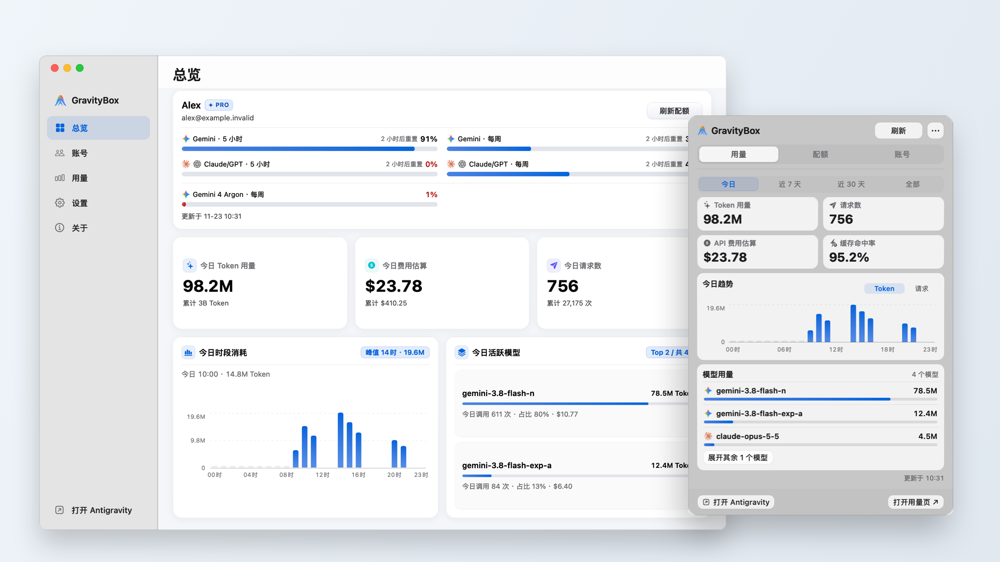
  </picture>
  <sub><em>macOS 原生主控制台与菜单栏浮窗（Swift 6 / AppKit，跟随深浅色模式）— Windows x64 端提供功能对等的 Tauri 2 / React 控制台与系统托盘浮窗</em></sub>
</div>

---

## 概览

**GravityBox**（`GravityBox v1.2.2`）是一款专为 **Google Antigravity** 官方正式版打造的轻量级、零侵入、重隐私伴侣工具箱，覆盖 **macOS（原生主线，作者主导并实机验收）** 与 **Windows x64（`v1.2.1` 起由社区共建合入：`#27`、`#30`、`#32` 致谢 `@Agonie0v0` 贡献实现并完成真机验收，随 `v1.2.1` 同步分发）**。双端共享同一套内置 Node 22 核心引擎，全程通过本机回环 CDP 与只读 SQLite 事务工作，绝不解包、篡改或重签名官方应用包。

| 核心能力 | 解决什么问题 |
| :--- | :--- |
| **零改包双语适配** | 运行时动态切换简体中文与英文界面（词典指纹已覆盖 `2.23.0`–`2.34.0`，`2.35.0+` 自动进入自适应兼容模式），同时严格保护对话内容、代码块、Diff、CSV 视口、LSP 引用与 Notebook 代码/输出区不被改动。 |
| **对话状态栏 (HUD)** | 在每个聊天输入框正下方嵌入三联遥测条，实时展示轮次用时、输出速度、Token 消耗、缓存命中率、压缩次数与上下文水位。 |
| **双周期配额与账单** | 将 **5 小时** 滚动限额、**每周** 限额与独立高阶池（如 `Gemini 4 Argon`）拆开展示；汇总页自动合并同一模型的各思考档位变体（`-low` 至 `-max`），并按时序官方单价核算等效 API 费用。 |
| **SSH 远程窗口与统一账本** | 无需调用外部 `ssh` 进程即可适配 Antigravity `2.33.0+` SSH 远程窗口（双语界面、实时 HUD、按主机只读配额），并将本机与 SSH 会话用量统一合账且支持「环境 × 账号」正交筛选。 |
| **HTTP / HTTPS 网络代理** | 支持 **关闭**、**自动跟随系统代理**（macOS / Windows 系统设置）或 **手动指定** `http://` / `https://` 代理地址，自动为 Antigravity 注入代理环境变量、让 GravityBox 后台外联复用同一代理，并检测 Shell 覆盖冲突。 |
| **多账号与 CLI 同步** | 支持保存当前会话、JSON 批量导入与确认后备份导出（macOS 锁定 `0600`）、低配额智能推荐、同源 `agy` CLI 凭据非侵入同步，以及四阶段原子安全切换与异常自动回滚。 |
| **可撤回缓存瘦身** | 仅清理无状态运行缓存与可选超期后台日志（清理前归档账单），统一移入 macOS 废纸篓或 Windows 回收站（`IFileOperation`）并支持一键原位还原，登录凭据与聊天正文受白名单隔离保护。 |

---

## 平台支持与验收边界

| 目标平台 | 前端与系统助手 | IPC 与凭据机制 | 分发产物与验收状态 |
| :--- | :--- | :--- | :--- |
| **macOS 14+ (Apple Silicon `arm64`)** | 原生 **Swift 6 / AppKit** 五页主控制台与 `MenuFloatingPanel`（`native/`） | Unix Domain Socket IPC · macOS 钥匙串与 `0600` 本地文件 | **原生主线（作者已实机验收）**：通过 [GitHub Releases](https://github.com/Enzoo404/gravitybox/releases/latest) 直接下载预构建 `GravityBox-<version>-arm64.dmg` |
| **Windows 10/11 (x64)** | **Tauri 2 / React 19** 五页控制台与系统托盘面板（`windows/app/`）+ 静态链接 Rust Win32 助手（`windows/win-helper/`） | 每启动随机 Named Pipe（256-bit `authToken`、同用户 SID 与完整性校验）· Windows Credential Manager（2560 字节容量边界与内存清零） | **社区共建端（`@Agonie0v0` 已完成真机验收）**：通过 [GitHub Releases](https://github.com/Enzoo404/gravitybox/releases/latest) 随 `v1.2.1` 同步提供预构建自包含 `-setup.exe` 与便携 `.zip`（**普通用户无需自行构建**） |

---

## 快速上手

> GitHub Releases 的 macOS 预构建包目前仅面向 Apple Silicon（`arm64`）。Intel（`x86_64`）用户可[从源码在本机验证并打包](#架构与源码构建)。

### macOS（原生主线 · Apple Silicon）

1. **下载与安装**：前往 [GitHub Releases](https://github.com/Enzoo404/gravitybox/releases/latest) 获取最新 `GravityBox-<version>-arm64.dmg`，将 **GravityBox.app** 拖入 **Applications**。因开源版本未经过 Apple 付费公证，首次运行前在终端执行一次放行命令即可（也可在「系统设置 → 隐私与安全性」点击仍要打开）：
   ```bash
   xattr -cr /Applications/GravityBox.app
   ```
2. **启动并连接**：打开 **GravityBox**，通过侧栏或菜单栏点击 **「打开 Antigravity」**，或在 **设置 → 启动时自动打开 Antigravity** 开启后，打开 GravityBox 自动驻留菜单栏并拉起带调试端口的 Antigravity。若 `2.33.0+` 客户端是从外部直接启动且未开启调试端口，面板会弹出「未开启调试端口」横幅，点击 **「安全重启以连接」** 即可直接优雅重启并挂载（不在后台强杀进程）。
3. **日常协作**：写代码时直接看输入框下方 **HUD**；查额度/快速切号直接唤起 **菜单栏浮窗**（支持 `⌘1/2/3` 快捷键与全屏跨空间展示）；深度分析与整理打开 **主控制台**（总览 · 账号 · 用量 · 设置 · 关于）。

### Windows x64（社区共建端）

1. **直接下载（无需自行打包构建）**：前往 [GitHub Releases](https://github.com/Enzoo404/gravitybox/releases/latest) 直接下载开箱即用的自包含产物——`GravityBox-<version>-win-x64-setup.exe`（用户级安装程序，默认安装到 `%LOCALAPPDATA%\Programs\GravityBox`，无需管理员权限）或 `GravityBox-<version>-win-x64.zip`（便携包，解压即用），已内置 Node 22 与 Win32 助手，**普通用户无需自己运行编译或打包命令**。*（已由 `@Agonie0v0` 完成 Windows 真机验收，随 `v1.2.1` 同步分发。）*
2. **启动并连接**：运行 `GravityBox.exe`（需 Windows 10/11 x64 及系统 WebView2 运行时）。通过侧栏或系统托盘菜单点击 **「打开 Antigravity」**，或开启 **设置 → 启动时自动打开 Antigravity**。若外部启动的 Antigravity 未开启调试端口，点击横幅 **「安全重启以连接」** 即可优雅重启（严格遵守 Windows UIPI 与同用户 SID 边界，绝不静默调用 `TerminateProcess` 强杀官方编辑器）。
3. **日常协作**：在 Antigravity 内直接查看 **HUD**；点击 **系统托盘浮窗** 快速浏览额度、用量与切换账号；打开 **主控制台**（总览 · 账号 · 用量 · 设置 · 关于）进行多账号与账单管理。

---

## 对话状态栏 (HUD)

HUD 挂载于每个 Antigravity 对话输入框下方（含 `2.34.0+` 的 BTW 侧边提问独立分栏，且自动去重克隆前缀用量），支持分栏独立状态且不抢占输入焦点。

<div align="center">
  <picture>
    <source media="(prefers-color-scheme: dark)" srcset="assets/screenshots/hud-dark.png" />
    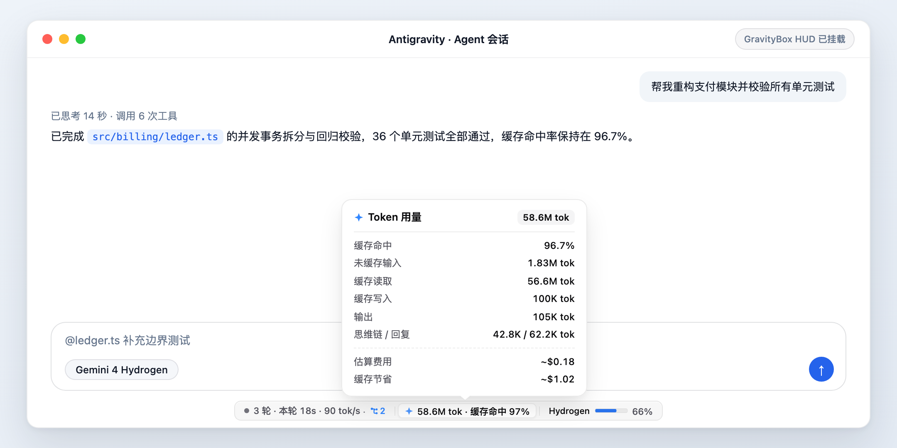
  </picture>
</div>

<br />

<div align="center">
  <picture>
    <source media="(prefers-color-scheme: dark)" srcset="assets/screenshots/hud-capsules-dark.png" />
    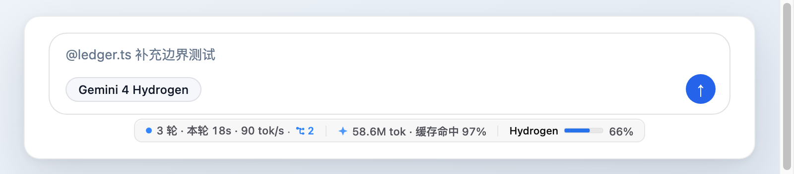
  </picture>
</div>

| 位置 | 示例读数 | 说明 |
| :--- | :--- | :--- |
| **1. 对话与速度** | 灰 / 实心蓝 / 呼吸蓝圆点 + `3 轮 · 本轮 18s · 90 tok/s · 2` | 状态灯指示当前前台活动（**灰** 空闲或仅后台子智能体运行，**实心蓝** 模型思考/输出，**呼吸蓝** 工具调用）；右侧依次为轮次、当前轮用时、平均吐字速度及并行子智能体数量。 |
| **2. Token 与缓存** | `58.6M tok · 缓存命中 97%` | 本会话（含关联子智能体）累计消耗总 Token 及输入缓存复用比例。 |
| **3. 上下文水位** | 压缩徽章 (`1` / `2` / `3+`) + 模型短标 + 进度条 (`66%`) | 发生自动压缩后才显现对应颜色角标；多模型或编排场景显示当前模型简称；未返回精确容量时带 `~` 按参考上限估算。 |

### 向上展开详情卡片

悬停或点击任意胶囊可弹出明细卡片（`Esc` 或点击空白处收起）：

<table>
  <tr>
    <td width="33.3%" align="center">
      <b>对话统计</b><br /><br />
      <picture>
        <source media="(prefers-color-scheme: dark)" srcset="assets/screenshots/hud-card-session-dark.png" />
        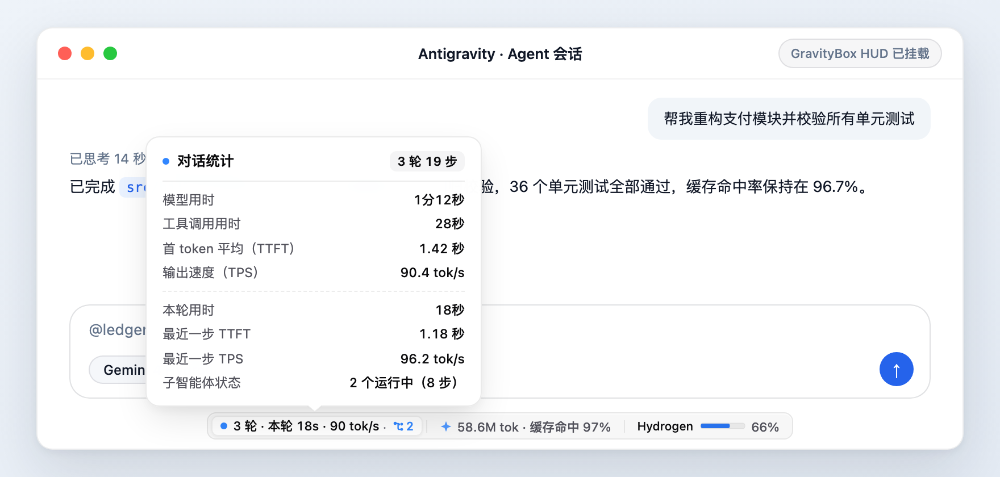
      </picture>
    </td>
    <td width="33.3%" align="center">
      <b>Token 用量</b><br /><br />
      <picture>
        <source media="(prefers-color-scheme: dark)" srcset="assets/screenshots/hud-card-tokens-dark.png" />
        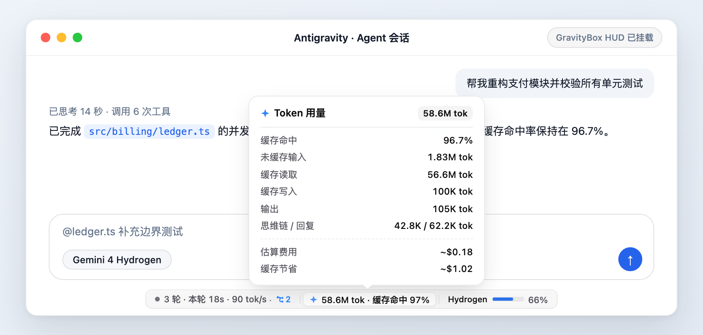
      </picture>
    </td>
    <td width="33.3%" align="center">
      <b>当前上下文</b><br /><br />
      <picture>
        <source media="(prefers-color-scheme: dark)" srcset="assets/screenshots/hud-card-context-dark.png" />
        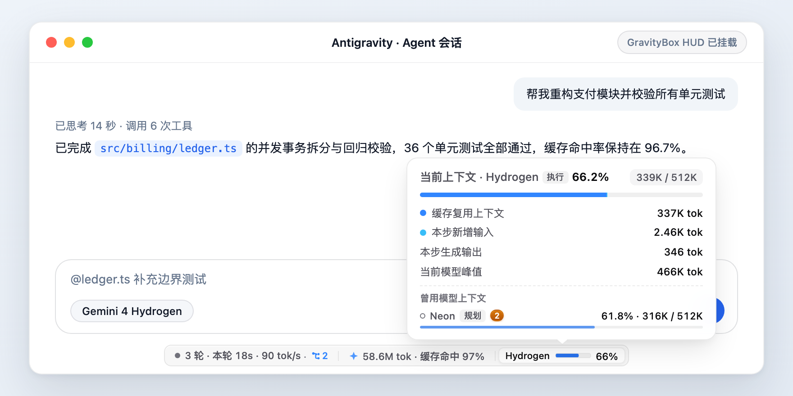
      </picture>
    </td>
  </tr>
</table>

<details>
<summary>卡片指标补充与编排器上下文追踪</summary>

- **对话统计**：拆分模型与工具累计耗时（自动合并并行工具重叠时间），展示全局平均与最近一步的 TTFT / TPS，以及子智能体运行步数。
- **Token 用量**：细分为未缓存输入、缓存读取、缓存写入与输出（模型支持时自动拆分 `思维链 / 回复`），并按当时生效费率折算等效 API 费用与缓存节省金额（含未公开定价模型时显示 `≥ $X`）。
- **当前上下文**：单行标题融合当前模型名与角色徽章（`规划` / `执行`），配合双色进度条（缓存复用 vs. 本步新增输入）、本步输出与模型历史峰值，并以统一磨砂中性灰胶囊在 **曾用模型上下文** 列表展示切换过的模型水位与压缩次数（`v1.2.1` 通过 `executor_metadata` 增量扫描在对话回退/截断场景下保留历史编排器角色）。

</details>

---

## 界面与核心机制

> *以下截图摄于已实机验收的 macOS 原生端（Swift 6 / AppKit）。Windows x64 端（Tauri 2 / React）已同步实现功能对等的五页主控制台（总览 · 账号 · 用量 · 设置 · 关于）与系统托盘面板（已由 `@Agonie0v0` 完成真机验收，Windows 实机截图后续补充）。*

<table>
  <tr>
    <td width="50%" align="center">
      <b>总览</b><br /><br />
      <picture>
        <source media="(prefers-color-scheme: dark)" srcset="assets/screenshots/dark-overview.png" />
        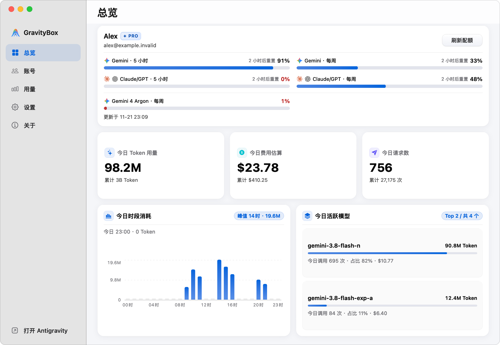
      </picture>
    </td>
    <td width="50%" align="center">
      <b>账号</b><br /><br />
      <picture>
        <source media="(prefers-color-scheme: dark)" srcset="assets/screenshots/dark-accounts.png" />
        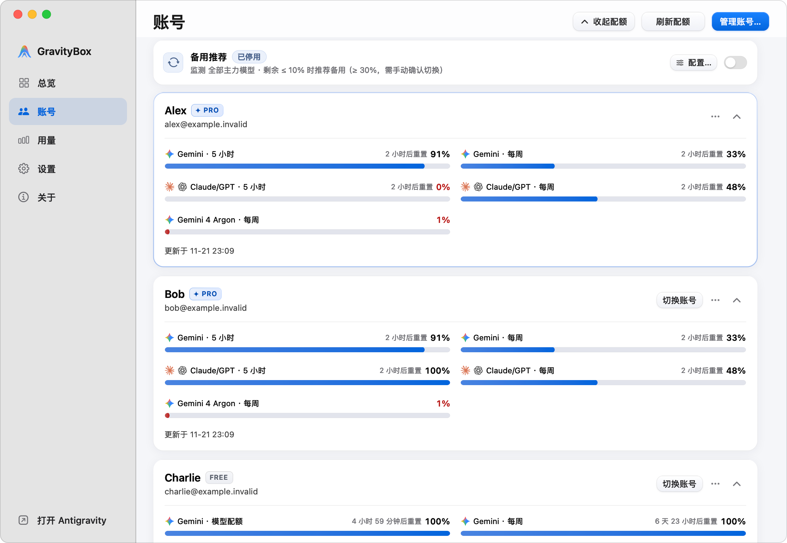
      </picture>
    </td>
  </tr>
  <tr>
    <td width="50%" align="center">
      <b>用量与费用</b><br /><br />
      <picture>
        <source media="(prefers-color-scheme: dark)" srcset="assets/screenshots/dark-usage.png" />
        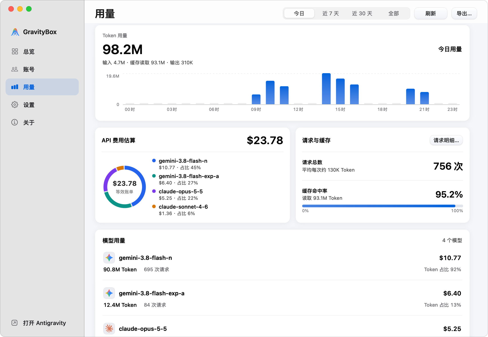
      </picture>
    </td>
    <td width="50%" align="center">
      <b>设置</b><br /><br />
      <picture>
        <source media="(prefers-color-scheme: dark)" srcset="assets/screenshots/dark-settings.png" />
        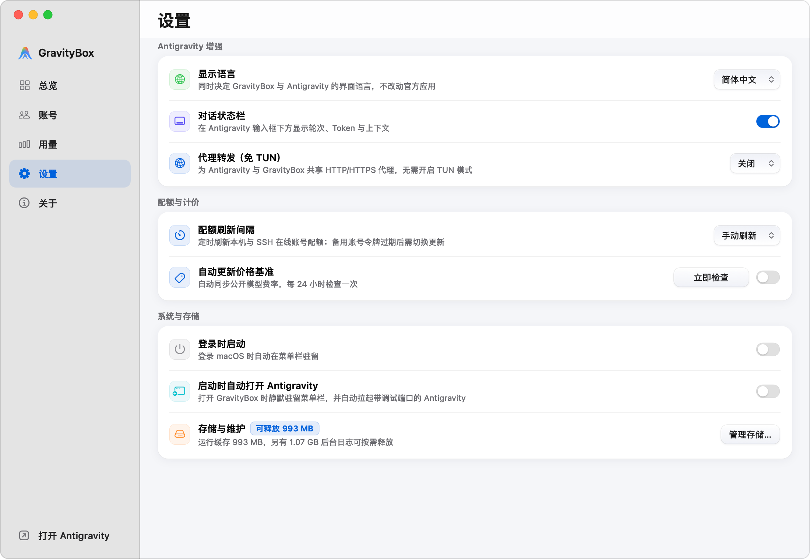
      </picture>
    </td>
  </tr>
</table>

<details>
<summary>展开更多截图：常驻菜单栏浮窗、存储与维护、关于页面</summary>
<br />
<table>
  <tr>
    <td width="33.3%" align="center">
      <b>菜单栏 · 用量</b><br /><br />
      <picture>
        <source media="(prefers-color-scheme: dark)" srcset="assets/screenshots/dark-menubar.png" />
        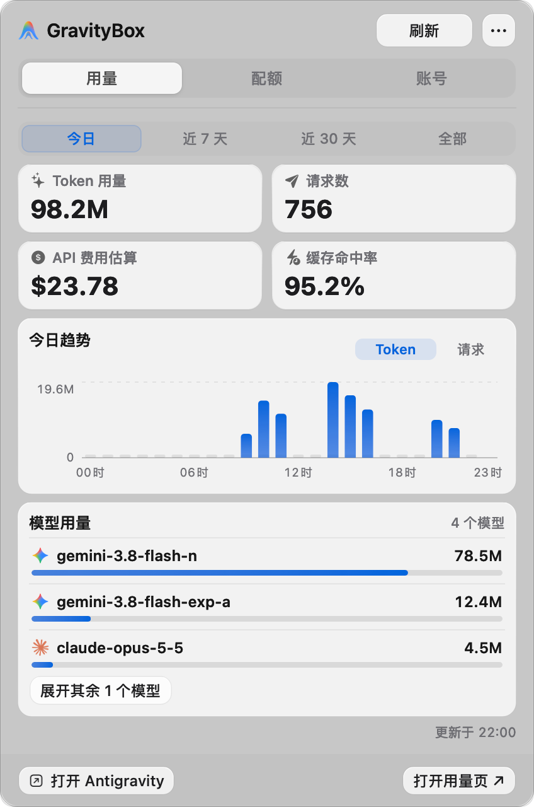
      </picture>
    </td>
    <td width="33.3%" align="center">
      <b>菜单栏 · 配额</b><br /><br />
      <picture>
        <source media="(prefers-color-scheme: dark)" srcset="assets/screenshots/dark-menubar-quota.png" />
        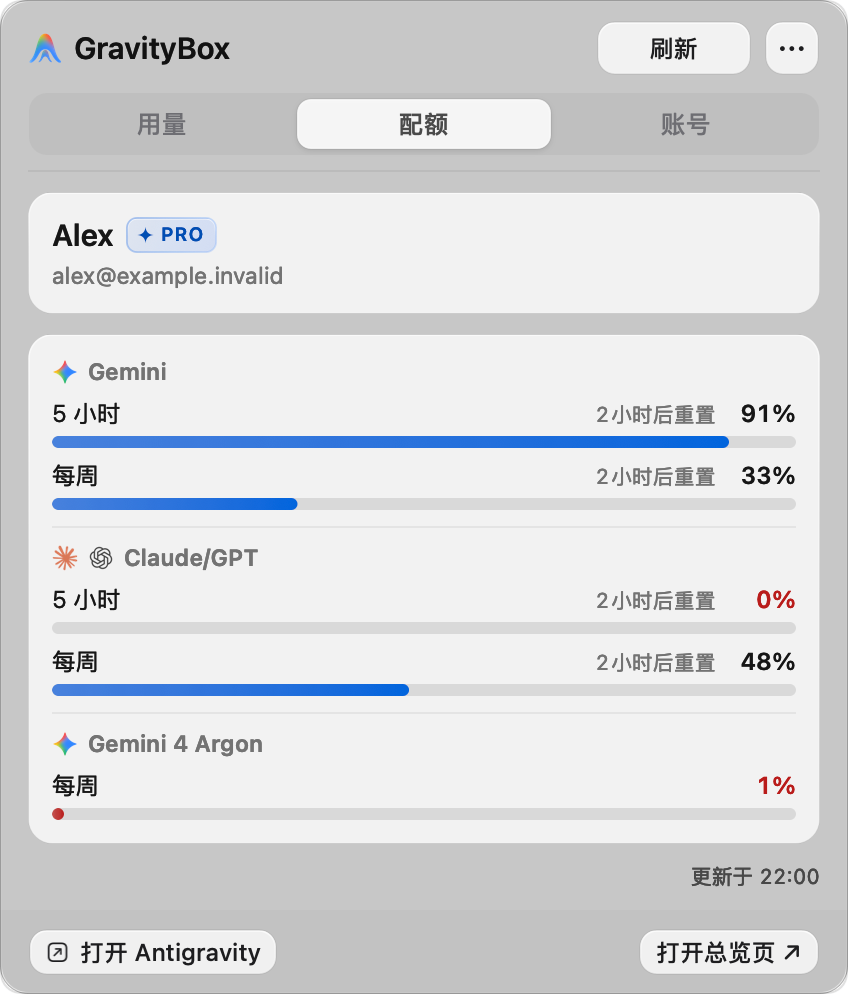
      </picture>
    </td>
    <td width="33.3%" align="center">
      <b>菜单栏 · 账号</b><br /><br />
      <picture>
        <source media="(prefers-color-scheme: dark)" srcset="assets/screenshots/dark-menubar-accounts.png" />
        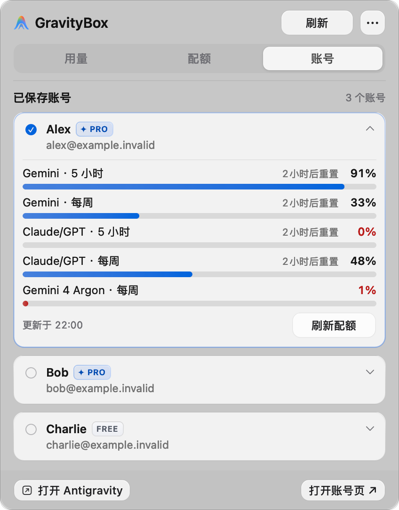
      </picture>
    </td>
  </tr>
  <tr>
    <td colspan="2" align="center">
      <b>存储与维护（废纸篓清理与原位还原）</b><br /><br />
      <picture>
        <source media="(prefers-color-scheme: dark)" srcset="assets/screenshots/dark-maintenance.png" />
        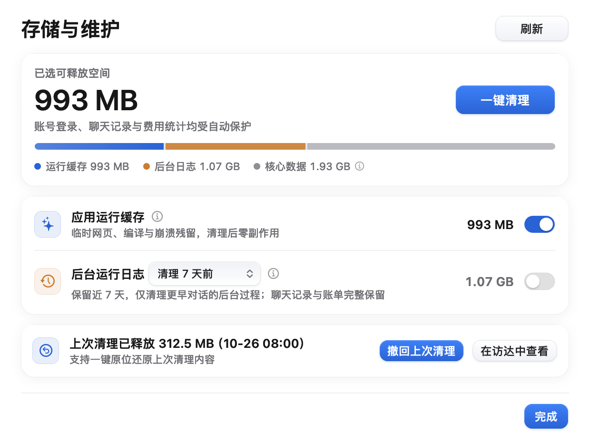
      </picture>
    </td>
    <td align="center">
      <b>关于与更新</b><br /><br />
      <picture>
        <source media="(prefers-color-scheme: dark)" srcset="assets/screenshots/dark-about.png" />
        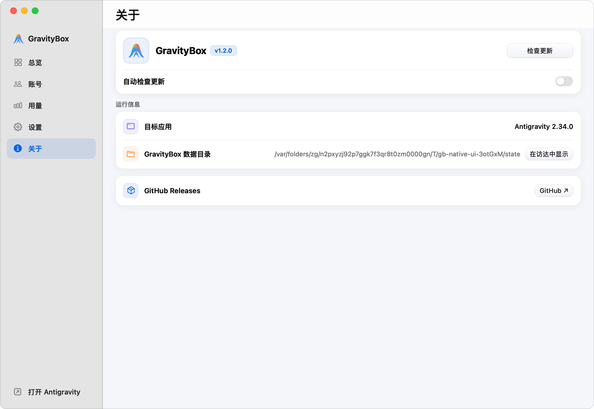
      </picture>
    </td>
  </tr>
</table>
</details>

### v1.2.1 核心机制说明

- **Windows x64 社区共建跨平台支持（`#27`、`#30`、`#32`，致谢 `@Agonie0v0` 贡献实现）**：引入同仓隔离的跨平台后端抽象（`src/platform/`）、原生 Rust Win32 助手（`windows/win-helper`，提供凭据管理器、SID 鉴权 Named Pipe、非破坏性 `IFileOperation` 回收站迁移与严格优雅退出边界）、Tauri 2 Windows 桌面控制台与托盘浮窗（`windows/app`），以及独立非阻塞 `windows-latest` CI 与自包含 ZIP / NSIS 安装包构建流（`tools/package-win.mjs`），所有 Windows 专属文件与 macOS `sourceDigest` 彻底隔离。
- **进程隔离、HUD 精度与视图保护加固（`#28`、`#33`，致谢 `@lvyandev` 与 `@MongoRolls`）**：在切号、回滚与存储维护期间隔离 `chrome_crashpad_handler` 与已脱离主进程树的后台守护进程（`language_server` / `sidecar`，`#28`）；细化权限四档翻译并新增代码查看、Diff、CSV 视口、LSP 引用与 Notebook 代码/输出区防误译保护（`#33`）；通过 `executor_metadata` 增量扫描保留对话回退/截断后的历史编排器角色；对齐 Windows 凭据 2560 字节边界、Named Pipe 完整性校验、NTFS 锁退避及请求明细全量分页导出。
- **启动时自动打开 Antigravity**：因新版 Antigravity 默认不再开启调试端口（且本工具坚持不修改官方安装包），原「跟随 Antigravity 启停」已替换为 **设置 → 启动时自动打开 Antigravity**。开启后，打开 GravityBox 会自动静默驻留菜单栏 / 系统托盘并拉起带 `--remote-debugging-port=0` 调试端口的 Antigravity。
- **SSH 远程窗口零外部 SSH 适配与多主机视图**：通过本机 CDP 通道直接适配 Antigravity `2.33.0+` SSH 远程窗口，不拉起任何外部 `ssh` 进程——提供完整双语热适配、实时对话状态栏 HUD、严格隔离本机账号的 `本机 / SSH: <host>` 只读双周期配额查看、切号/安全重启/维护时的活跃 SSH 保护提醒，以及 **总览** 伴生 SSH 主机列表与 **菜单栏 / 托盘浮窗** 可展开范围切换器。
- **本机 + SSH 统一多环境用量账本**：增量同步远端会话用量至本地 SQLite 账本（按远端轨迹 ID 去重并基于时间线判定账号归属），提供默认合并总览、`本机 % · SSH %` 环境占比条、`环境 × 账号` 正交筛选与离线 SSH 历史徽标。
- **BTW 侧边提问分栏隔离与 `2.34.0` 目录更新**：独立观测 `2.34.0` BTW 侧边提问分栏 HUD 并在用量核算中自动去重克隆前缀生成记录，同时收录 `2.34.0` 官方词典并为 `gemini-2.5-pro` 补全 `>200K` 上下文阶梯定价。
- **HTTP / HTTPS 网络代理支持**：在 **设置** 中选择 **关闭**、**跟随系统代理** 或 **手动配置** `http://` / `https://` 代理（不支持 PAC 与 SOCKS5）。GravityBox 启动 Antigravity 时自动注入 `HTTP_PROXY` / `HTTPS_PROXY` / `NO_PROXY`，自身外联请求共享同一代理通道，并实时检测运行中进程的代理不匹配或 Shell 覆盖状态。
- **Antigravity `2.34.0+` 备用账号配额追踪**：当前正在使用的账号通过进程环境变量读取，无需额外配置即可持续实时刷新。受 `2.34.0` 本地通道仅限单一活跃会话、以及 GravityBox 坚持纯本地开源（不内置官方客户端密钥、不设中转服务器）的限制，未激活的备用账号离开约 1 小时登录态过期后不再后台拉取云端额度；GravityBox 会在过期前自动补刷、超时后静默跳过不弹窗报错、保留上次快照并按重置时间标示 **「预计已重置」** 供智能推荐参考，待手动切回该账号时同步最新余额。
- **JSON 批量管理与 `agy` CLI 同步**：集成保存当前账号、JSON 文件/目录批量导入（按邮箱去重）与二次确认备份导出（macOS 锁定 `0600`）；切号与撤销回滚时会顺带更新本机已存在的 `antigravity-oauth-token` 与 `jetski-standalone-oauth-token`，不干扰 `@google/gemini-cli` 凭据。
- **思考档位折叠与价格表热更新**：主界面与浮窗自动将同一基础模型的 `-low`、`-medium`、`-high`、`-xhigh`、`-thinking`、`-max`、`-tiered` 等变体合并展示汇总消耗（请求明细流水保留原始标识）；开启 **「自动更新价格基准」** 或点击 **「立即检查」** 可在线热同步最新公开模型单价表。
- **独立双语与 HUD 开关**：在设置页或菜单栏 / 托盘 `···` 菜单随时切换 **跟随系统 / 简体中文 / English**，无需重启；选择 `English` 恢复官方英文界面时，仍可保持英文版 HUD 正常工作。

---

## 安装与升级

- **macOS（原生主线）**：macOS 14 (Sonoma) 或更高版本、官方正式版 `/Applications/Antigravity.app`（不支持也不干扰 Insiders 预览版），内置运行环境、零外部依赖。
  - SHA-256 校验（可选）：`shasum -a 256 -c GravityBox-<version>-arm64.dmg.sha256`
  - 无损升级：退出旧版 GravityBox 后将新版拖入 `/Applications` 替换，或在 **关于** 页检查更新（默认关闭后台检查）。
  - GitHub Releases 提供 Apple Silicon（`arm64`）DMG。Intel（`x86_64`）在源码目录运行 `npm run verify` 与 `npm run package:mac`，再安装本地产出的 DMG；升级时用新版源码重新构建。
- **Windows x64（社区共建端）**：Windows 10/11 x64（需系统 WebView2 运行时）及官方正式版 Antigravity；由维护者/CI 统一构建开箱即用的自包含安装版（`GravityBox-<version>-win-x64-setup.exe`）与便携版（`GravityBox-<version>-win-x64.zip`，均附 `.sha256` 校验文件），已由 `@Agonie0v0` 完成真机验收，随 `v1.2.1` 直接发布至 [GitHub Releases](https://github.com/Enzoo404/gravitybox/releases/latest)，**普通用户无需自行编译打包**。
  - PowerShell 校验（可选）：`Get-FileHash GravityBox-<version>-win-x64.zip -Algorithm SHA256`
- **本地数据与缓存路径**：
  - macOS：状态库 `~/Library/Application Support/GravityBox`（缓存位于 `~/Library/Caches/GravityBox`）
  - Windows：状态库 `%APPDATA%\GravityBox`（缓存位于 `%LOCALAPPDATA%\GravityBox\Cache`，日志位于 `%LOCALAPPDATA%\GravityBox\Logs`）

<details>
<summary>进阶可选：为过期备用账号配置后台云端刷新凭据</summary>

日常使用（多账号切号、当前账号实时配额、HUD 状态栏、用量账单与汉化）无需此配置。仅当需要未激活备用账号在过期后继续自动拉取云端配额时，才需在 `~/Library/Application Support/GravityBox/.env`（macOS）或 `%APPDATA%\GravityBox\.env`（Windows）中写入兼容的 OAuth 客户端凭据：

```bash
GRAVITYBOX_GOOGLE_CLIENT_ID="your-client-id.apps.googleusercontent.com"
GRAVITYBOX_GOOGLE_CLIENT_SECRET="your-client-secret"
```

</details>

---

## 安全与隐私边界

| 安全原则 | 工程实现 |
| :--- | :--- |
| **零遥测零上报** | 无第三方统计或崩溃上报 SDK，无后台静默外联请求；更新检查与价格同步默认均关闭。 |
| **不改动官方包** | 仅通过本机回环（`127.0.0.1`）CDP 隔离世界运行，不解包、不改写、不重签名官方 Antigravity 安装包或可执行文件。 |
| **用户内容隔离** | 输入框草稿、对话正文、代码块、Diff、CSV 视口、LSP 引用、Notebook 代码/输出区、终端输出、文件名与项目名由 DOM 选择器与白名单严格隔离。 |
| **本机隔离存储与 IPC 鉴权** | **macOS**：`~/Library/Application Support/GravityBox`（`0700`/`0600`）、Keychain 与 Unix Domain Socket IPC。<br/>**Windows**：`%APPDATA%\GravityBox`、Windows Credential Manager（2560 字节守卫与内存清零）、带 256-bit `authToken` 及同用户 SID/完整性校验的随机 Named Pipe、最小权限 Tauri CSP/URL 白名单、`IFileOperation` 回收站路径守卫及 UIPI 优雅退出边界。 |

---

## 架构与源码构建

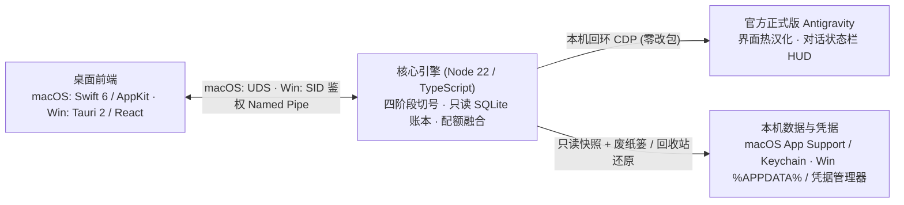

- **macOS 构建依赖**：Xcode Command Line Tools 与匹配构建架构（`arm64` 或 `x64`）的 Node.js `>=22.15.0 <23`。运行 `node tools/setup-test-browser.mjs` 准备固定版本的无头浏览器，也可指定 `CHROME_BIN`。
- **Windows 构建依赖**：Windows 10/11 x64、Node.js `>=22.15.0 <23`、Rust（`cargo` / `rustc`）、MSVC 与 WebView2 构建工具（构建 `.exe` 安装包另需 NSIS）。维护者与 CI 亦可通过手动运行 `Package Windows (Artifact Only)` 工作流直接产出预构建 Windows 测试包。

```bash
git clone https://github.com/Enzoo404/gravitybox.git
cd gravitybox
npm ci

npm test                # 编译 TS、校验价格资产并运行单元/集成测试
npm run check:swift     # Swift 6 AppKit 编译与布局检查（macOS）
npm run verify          # 全量发布门禁（TS + 单测 + 无头浏览器 E2E + Swift -O + 词典门禁）
npm run package:mac     # 按本机 macOS 架构（arm64 / x86_64）构建 .app 与 .dmg
npm run test:win        # 运行后端快测 + Win32 助手与 Tauri Rust 测试（Windows）
npm run package:win     # 构建 Windows 自包含 .zip（附加 --installer 生成 NSIS .exe）
```

<details>
<summary>仓库目录结构</summary>

```text
gravitybox/
├── native/       # Swift 6 / AppKit 主控制台、MenuFloatingPanel、双语运行时与更新器（macOS）
├── src/          # TypeScript 核心引擎（IPC、双语控制、四阶段切号、配额融合、SQLite 账本、HUD、platform/）
├── windows/      # 同仓隔离的 Windows x64 客户端（win-helper Rust Win32 助手 + Tauri 2 / React 桌面端）
├── runtime/      # CDP 注入脚本（DOM 增量翻译、保护守卫与双语 Telemetry HUD）
├── dict/         # 分层词典与本地覆盖配置
├── ui-strings/   # 各受支持正式版官方界面文案快照（2.23.0 – 2.34.0）
├── assets/       # 图标、i18n 语言包、模型目录、时序价格表与 macOS Retina 实机截图
├── test/         # 单元/集成、无头 Chromium 浏览器回归、跨平台隔离及原生 Swift UI 测试套件
└── tools/        # 发布完整性校验、隐私扫描、文档检查、截图生成、DMG 与 Windows 打包脚本
```

</details>

---

## 常见问题

<details>
<summary><b>为什么切号前需要先退出 Antigravity？</b></summary>

Antigravity 运行时会持续持有本地 SQLite（`state.vscdb`）与认证文件锁，后台强杀或覆写运行中的数据库文件存在损库与草稿丢失风险。GravityBox 先确认安全退出（仅使用优雅关闭），再执行四阶段快照切换并在异常时原位回滚，切号动作始终由你确认。

</details>

<details>
<summary><b>只想开启输入框 HUD，不汉化 Antigravity 可以吗？</b></summary>

可以。在 **设置 → 显示语言** 中选择 **English**，同时保持 **对话状态栏** 开关开启，Antigravity 将保持原生英文界面并在输入框下方展示英文 HUD。

</details>

<details>
<summary><b>如何卸载 GravityBox？</b></summary>

退出 GravityBox（官方 Antigravity 从未被修改过，无需额外还原）：
- **macOS**：将 `/Applications/GravityBox.app` 移入废纸篓即可；如无需保留历史账单与账号配置，再删除 `~/Library/Application Support/GravityBox`。
- **Windows**：运行卸载程序（或删除便携目录），如无需保留历史账单与账号配置，再删除 `%APPDATA%\GravityBox` 与 `%LOCALAPPDATA%\GravityBox`。

</details>

---

## 参与贡献、致谢与开源协议

提交代码或反馈请先阅读 [CONTRIBUTING.md](./CONTRIBUTING.md)、[CODE_OF_CONDUCT.md](./CODE_OF_CONDUCT.md)、[SECURITY.md](./SECURITY.md) 与 [CHANGELOG.md](./CHANGELOG.md)，欢迎在 [GitHub Issues](https://github.com/Enzoo404/gravitybox/issues) 提交讨论。

**社区致谢**：
- **代码贡献**：`@Agonie0v0`（`#26` `sqlite-worker` 稳定性修复；`#27`、`#30`、`#32` Windows x64 跨平台同仓三阶段实现）
- **问题反馈与特性建议**：`@Rentrer`（`#15`）、`@Allenbayern`（`#19`、`#20`）、`@willingning-coder`（`#21`）、`@YangFuting`（`#24`）、`@lvyandev`（`#28`）、`@MongoRolls`（`#33`）

<div align="center">
  <a href="https://star-history.com/#Enzoo404/gravitybox&Date">
    
  </a>
</div>

<p align="center">
  <sub>基于 <a href="./LICENSE">MIT License</a> 开源 · 第三方许可见 <a href="./THIRD_PARTY_NOTICES.md">THIRD_PARTY_NOTICES.md</a> · 与 Google、Apple 或 Microsoft 官方无从属或背书关系。</sub>
</p>
