<div align="center">
  <a href="https://github.com/Enzoo404/gravitybox">
    
  </a>

  <h1>GravityBox</h1>

  <p>
    <strong>Cross-Platform Companion for Google Antigravity (macOS Apple Silicon · Windows x64 Community)</strong><br />
    Zero-Patch Bilingual UI · In-IDE Telemetry HUD · Dual-Window Quotas · Safe Account Switching · Reversible Cache Trim
  </p>

  <p>
    <a href="https://github.com/Agonie0v0/gravitybox/releases/latest"></a>
    <a href="https://github.com/Agonie0v0/gravitybox/actions/workflows/ci-windows.yml"></a>
    
    
    <a href="./LICENSE"></a>
  </p>

  <p>
    <a href="./README.md">简体中文</a> · <b>English</b>
  </p>

  <p>
    <a href="#windows-edition">Windows Edition</a> ·
    <a href="#overview">Overview</a> ·
    <a href="#platform-support">Platforms</a> ·
    <a href="#quick-start">Quick Start</a> ·
    <a href="#in-ide-telemetry-hud">Telemetry HUD</a> ·
    <a href="#console--workflows">Console &amp; Workflows</a> ·
    <a href="#installation--upgrades">Installation</a> ·
    <a href="#security--privacy">Security</a> ·
    <a href="#architecture--build">Build</a>
  </p>
</div>

> [!NOTE]
> **Windows Personal Fork (`Agonie0v0/gravitybox`, `v1.2.2-win`)** — Synced with upstream [Enzoo404/gravitybox](https://github.com/Enzoo404/gravitybox) `v1.2.2` (dual-platform unified account privacy masking, silent cleanup of recovery snapshots on account deletion, Windows close confirmation & `EXDEV` retry hardening), while preserving personal-fork enhancements:
> - **Passive Weekly Quota Client Attribution**: Passively estimates local client (incl. same-account SSH) vs. other clients' share of weekly quota pools from the local ledger and cached snapshots with zero extra network requests, with equivalent USD displays hidden.
> - **Usage Analytics Enhancements**: Streaming output speed (median `tok/s` over recent 10 replies & per-reply speed), model × thinking effort breakdown (`Minimal` / `Extra Low` / `Low` / `Medium` / `High` / `XHigh` / `Max` / `Thinking`), and custom date range query & export.
>
> - **Windows Downloads**: Get the user-level self-contained installer (`GravityBox-<version>-win-x64-setup.exe`), portable archive (`GravityBox-<version>-win-x64.zip`), and `.sha256` checksums from [GitHub Releases](https://github.com/Agonie0v0/gravitybox/releases/latest).
> - **Windows Local Development (Hot Reload)**:
>   - `npm run dev:win` — full-stack Windows dev (Vite HMR + Tauri Rust auto-rebuild/restart + backend `tsc --watch`).
>   - `npm run dev:backend` — backend hot reload (`tsc --watch` + `runtime/` watch + `node --watch dist/main.js`).
>   - `npm run verify` / `npm run package:win` / `npm run package:win:installer` — verification gate and self-contained packaging.
>
> <a id="windows-edition"></a>

<br />

<div align="center">
  <picture>
    <source media="(prefers-color-scheme: dark)" srcset="assets/screenshots/en-hero-dark.png" />
    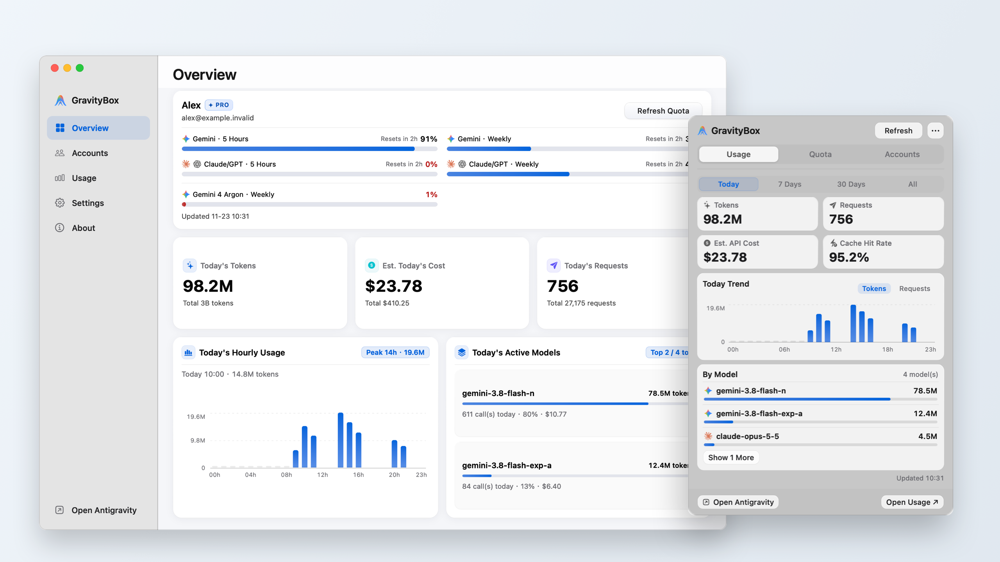
  </picture>
  <sub><em>macOS Native Console &amp; Menu Bar Panel (Swift 6 / AppKit, Light &amp; Dark) — Windows x64 ships a feature-parity Tauri 2 / React console &amp; system tray panel</em></sub>
</div>

---

## Overview

**GravityBox** (`GravityBox v1.2.2`) is a lightweight, privacy-first companion for the official stable release of **Google Antigravity**, covering **macOS** (Apple Silicon native prebuilt primary edition, plus local Intel `x86_64` source builds) and **Windows x64** (community-contributed edition with ready-to-run installers and portable builds). All editions share a self-contained Node 22 engine and communicate via local loopback CDP and read-only SQLite transactions—never unpacking, modifying, or re-signing the official Antigravity application bundle.

| Capability | What It Solves |
| :--- | :--- |
| **Runtime Localization** | Dynamically toggles Antigravity UI between English and Simplified Chinese (`2.23.0`–`2.34.0` verified dictionaries plus adaptive fallback for `2.35.0+`) with zero binary patches. Prompts, chats, code, diffs, CSV viewports, LSP references, and notebook code/output regions remain untouched. |
| **In-IDE Telemetry HUD** | Mounts a compact 3-capsule toolbar below each chat composer displaying turn time, TPS, token totals, cache hit rate, compaction state, and model context usage. |
| **Dual-Window Quotas & Usage** | Separates **5-Hour** rolling limits from **Weekly** caps and standalone high-tier pools (e.g. `Gemini 4 Argon`), aggregates thinking variants (`-low` to `-max`) in summaries, and tracks historical spend via dated official API rates. |
| **SSH Remote & Multi-Env Ledger** | Adapts Antigravity `2.33.0+` SSH remote windows over local CDP with zero external `ssh` calls—providing bilingual UI, live HUD, read-only per-host quotas, and a unified Local + SSH usage ledger with `Environment × Account` filtering. |
| **TUN-Free HTTP(S) Proxy** | Supports **Off**, automatic **System Proxy** (macOS / Windows settings), or **Manual** `http://` / `https://` endpoints without requiring a system TUN interface—injecting proxy variables into Antigravity, routing GravityBox outbound requests through the same proxy, and detecting shell overrides. |
| **Multi-Account, Privacy & CLI Sync** | Supports zero-config session capture, batch JSON import/export (`0600` on macOS), one-click account privacy masking (`⇧⌘M` / `Ctrl+Shift+M`), silent recovery snapshot cleanup on account deletion, standby recommendations, non-invasive `agy` CLI token sync, and atomic 4-phase manual switching with rollback. |
| **Reversible Storage Trim** | Moves runtime caches and optional aged task logs (archiving ledgers before cleanup) to macOS Trash or Windows Recycle Bin (`IFileOperation`) with one-click undo, while locking credentials, workspaces, and active chats behind a strict allowlist. |

---

## Platform Support

| Platform | Frontend & Helper | IPC & Credentials | Distribution & Acceptance Status |
| :--- | :--- | :--- | :--- |
| **macOS 14+ (Apple Silicon `arm64`)** | Native **Swift 6 / AppKit** 5-page console & `MenuFloatingPanel` (`native/`) | Unix Domain Socket IPC · macOS Keychain & `0600` local files | **Primary Edition (Author-verified)**: Prebuilt `GravityBox-<version>-arm64.dmg` via [GitHub Releases](https://github.com/Enzoo404/gravitybox/releases/latest) |
| **macOS 14+ (Intel `x86_64`)** | Same native **Swift 6 / AppKit** 5-page console & `MenuFloatingPanel` (`native/`) | Unix Domain Socket IPC · macOS Keychain & `0600` local files | **Local Source Build Support**: Host-architecture compilation, Mach-O validation, and architecture-safe updater; run `npm ci && npm run package:mac` to build a local `.app` and `.dmg` |
| **Windows 10/11 (x64)** | **Tauri 2 / React 19** 5-page console & tray panel (`windows/app/`) + static Rust Win32 helper (`windows/win-helper/`) | Per-startup randomized Named Pipe (256-bit `authToken`, SID & integrity verified) · Windows Credential Manager (2560-byte cap & zeroization) | **Community Edition (Real-machine verified)**: Prebuilt self-contained `-setup.exe` & portable `.zip` (**no user compilation required**) via [GitHub Releases](https://github.com/Enzoo404/gravitybox/releases/latest) |

---

## Quick Start

> Prebuilt macOS packages on GitHub Releases are currently Apple Silicon (`arm64`) only. Intel (`x86_64`) users can [verify and package a local build from source](#architecture--build).

### macOS (Primary · Apple Silicon / Intel Source Build)

1. **Install**: For Apple Silicon, download `GravityBox-<version>-arm64.dmg` from [GitHub Releases](https://github.com/Enzoo404/gravitybox/releases/latest) (Intel users can build locally via [Architecture & Build](#architecture--build)), drag **GravityBox.app** into **Applications**, and clear Gatekeeper quarantine once (or click **Open Anyway** in **System Settings → Privacy & Security**; open-source builds are not Apple-notarized):
   ```bash
   xattr -cr /Applications/GravityBox.app
   ```
2. **Launch & Connect**: Open **GravityBox** and start official `/Applications/Antigravity.app` from the sidebar/menu bar (`Open Antigravity`), or enable **Settings → Auto-Open Antigravity on Launch** so GravityBox stays in the menu bar and launches Antigravity with debugging enabled. If Antigravity `2.33.0+` was opened externally without a debugging port, click **Safe Relaunch to Connect** in the banner for a clean restart without force-killing active work.
3. **Use Across Three Surfaces**: Glance at the **HUD** below the composer while coding, click the **Menu Bar Panel** (`⌘1` / `⌘2` / `⌘3`) for instant checks across full-screen Spaces, or open the **Main Console** (`Overview · Accounts · Usage · Settings · About`).

### Windows x64 (Community Edition)

1. **Download (No Building Required)**: Download the ready-to-use self-contained package from [GitHub Releases](https://github.com/Enzoo404/gravitybox/releases/latest)—`GravityBox-<version>-win-x64-setup.exe` (user-level installer targeting `%LOCALAPPDATA%\Programs\GravityBox`, no admin elevation needed) or `GravityBox-<version>-win-x64.zip` (portable, extract and run). Both embed Node 22 and the Win32 helper—**end users never need to compile anything**.
2. **Launch & Connect**: Run `GravityBox.exe` (requires Windows 10/11 x64 and the system WebView2 runtime). Launch official stable **Antigravity** from the sidebar or system tray (`Open Antigravity`), or enable **Settings → Auto-Open Antigravity on Launch**. If Antigravity was started externally without a remote debugging port, use **Safe Relaunch to Connect** (GravityBox respects Windows UIPI / same-user SID boundaries and never silently `TerminateProcess`-kills the editor).
3. **Use Across Three Surfaces**: Inspect the **HUD** inside Antigravity, click the **System Tray Panel** for quick quota/usage/account checks, or open the **Main Console** (`Overview · Accounts · Usage · Settings · About`).

---

## In-IDE Telemetry HUD

The HUD embeds cleanly beneath every Antigravity composer—including isolated **BTW** side-question panes on `2.34.0+` (with cloned-prefix usage deduplicated)—without overlapping controls or taking keyboard focus.

<div align="center">
  <picture>
    <source media="(prefers-color-scheme: dark)" srcset="assets/screenshots/en-hud-dark.png" />
    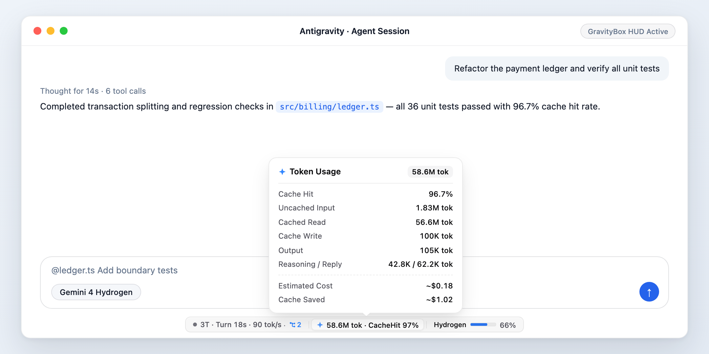
  </picture>
</div>

<br />

<div align="center">
  <picture>
    <source media="(prefers-color-scheme: dark)" srcset="assets/screenshots/en-hud-capsules-dark.png" />
    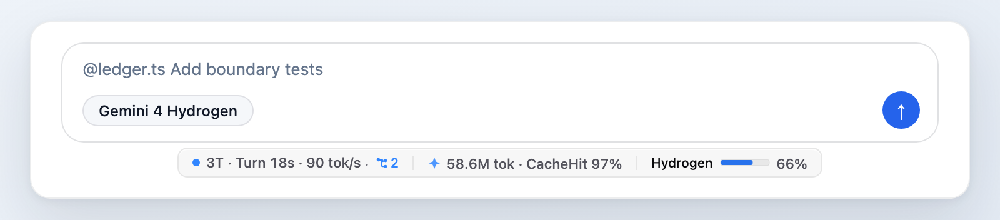
  </picture>
</div>

| Segment | Readout & Indicators | Meaning |
| :--- | :--- | :--- |
| **1. Session & Speed** | `Gray` / `Solid Blue` / `Breathing Blue` dot + `3T · Turn 18s · 90 tok/s · 2` | Dot reflects foreground state (**Gray** idle/waiting or background-only subagents, **Solid Blue** streaming/thinking, **Breathing Blue** tool execution). Shows user turns, live turn elapsed time, output speed, and active subagent count. |
| **2. Tokens & Cache** | `58.6M tok · Cache Hit 97%` | Cumulative session + subagent token volume and prompt cache reuse share. |
| **3. Context Meter** | Badge (`1` / `2` / `3+`) + Model tag + Meter (`66%`) | Compaction count badge (hidden until compacted), short active model tag when switching or orchestrating, and context fill (`~` denotes reference estimate when upstream capacity is omitted). |

### Upward Detail Popovers

Hover over or click any capsule to inspect its breakdown (`Esc` or click outside to dismiss):

<table>
  <tr>
    <td width="33.3%" align="center">
      <b>Session Stats</b><br /><br />
      <picture>
        <source media="(prefers-color-scheme: dark)" srcset="assets/screenshots/en-hud-card-session-dark.png" />
        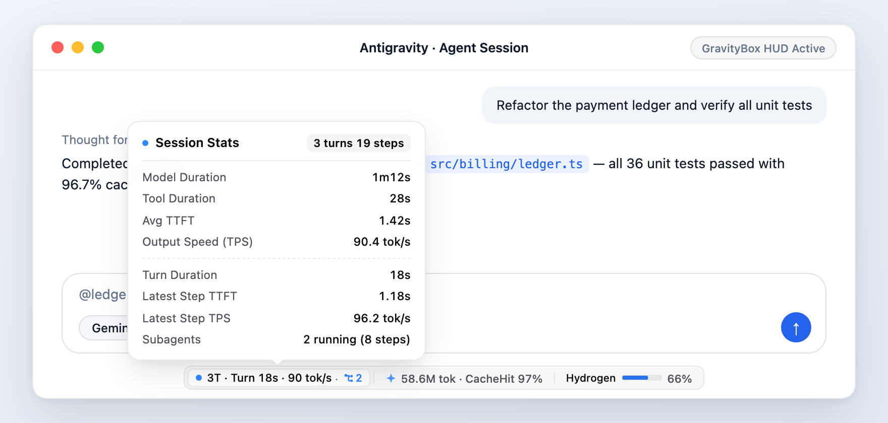
      </picture>
    </td>
    <td width="33.3%" align="center">
      <b>Token Usage</b><br /><br />
      <picture>
        <source media="(prefers-color-scheme: dark)" srcset="assets/screenshots/en-hud-card-tokens-dark.png" />
        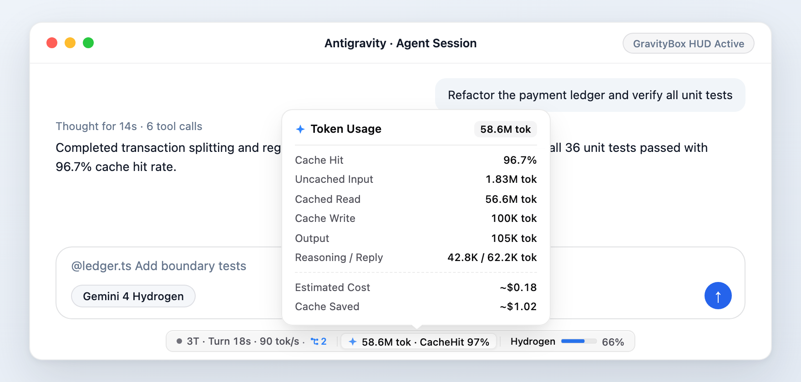
      </picture>
    </td>
    <td width="33.3%" align="center">
      <b>Current Context</b><br /><br />
      <picture>
        <source media="(prefers-color-scheme: dark)" srcset="assets/screenshots/en-hud-card-context-dark.png" />
        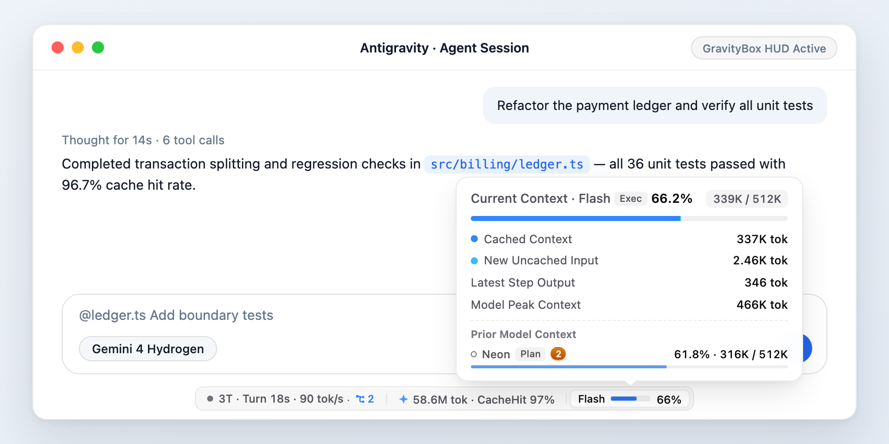
      </picture>
    </td>
  </tr>
</table>

<details>
<summary>Popover field highlights &amp; Orchestrator context tracking</summary>

- **Session Stats**: Splits cumulative Model vs. Tool duration (with parallel tool intervals deduplicated), overall Avg TTFT/TPS, and latest foreground step TTFT/TPS plus subagent step totals.
- **Token Usage**: Breaks down Uncached Input, Cached Read, Cache Write, and Output (with `Reasoning / Reply` split when provided), plus step-locked equivalent API dollar spend (`≥ $X` when an unpriced model is present) and Cache Saved.
- **Current Context**: Single-line header with active role pill (`Exec` / `Plan`), two-color fill bar (Cached Context vs. New Uncached Input), latest step output, model peak context, and a unified **Prior Model Context** list with neutral frosted role pills and compaction counts—preserving historical Orchestrator planner/executor roles across conversation truncation via incremental `executor_metadata` scanning.

</details>

---

## Console & Workflows

> *Screenshots below showcase the verified macOS Swift 6 / AppKit edition. On Windows x64, the Tauri 2 / React desktop app implements a feature-parity 5-page console (`Overview · Accounts · Usage · Settings · About`) and system tray panel (community-verified on real Windows hardware; Windows UI screenshots will be added in a follow-up update).*

<table>
  <tr>
    <td width="50%" align="center">
      <b>Overview</b><br /><br />
      <picture>
        <source media="(prefers-color-scheme: dark)" srcset="assets/screenshots/en-dark-overview.png" />
        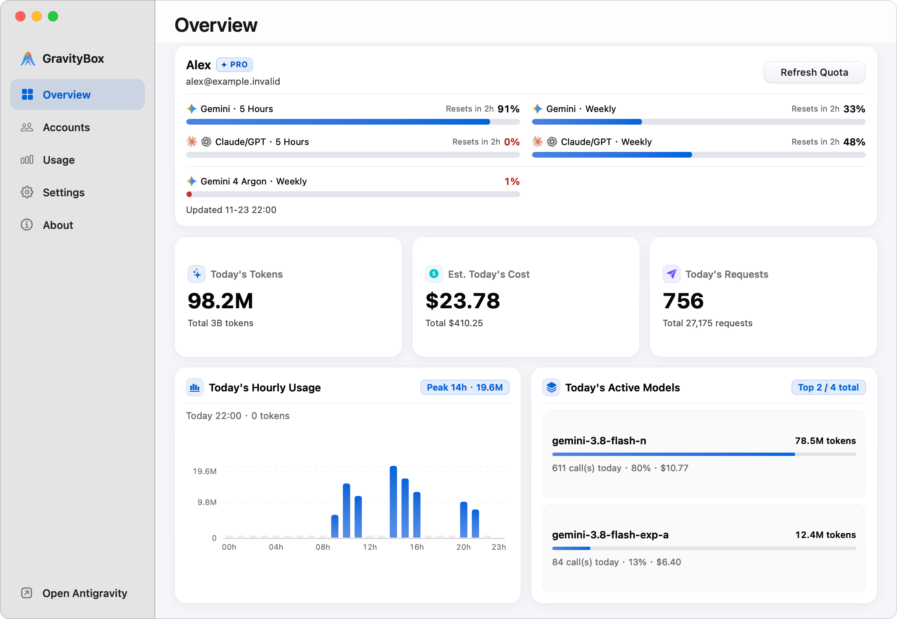
      </picture>
    </td>
    <td width="50%" align="center">
      <b>Accounts</b><br /><br />
      <picture>
        <source media="(prefers-color-scheme: dark)" srcset="assets/screenshots/en-dark-accounts.png" />
        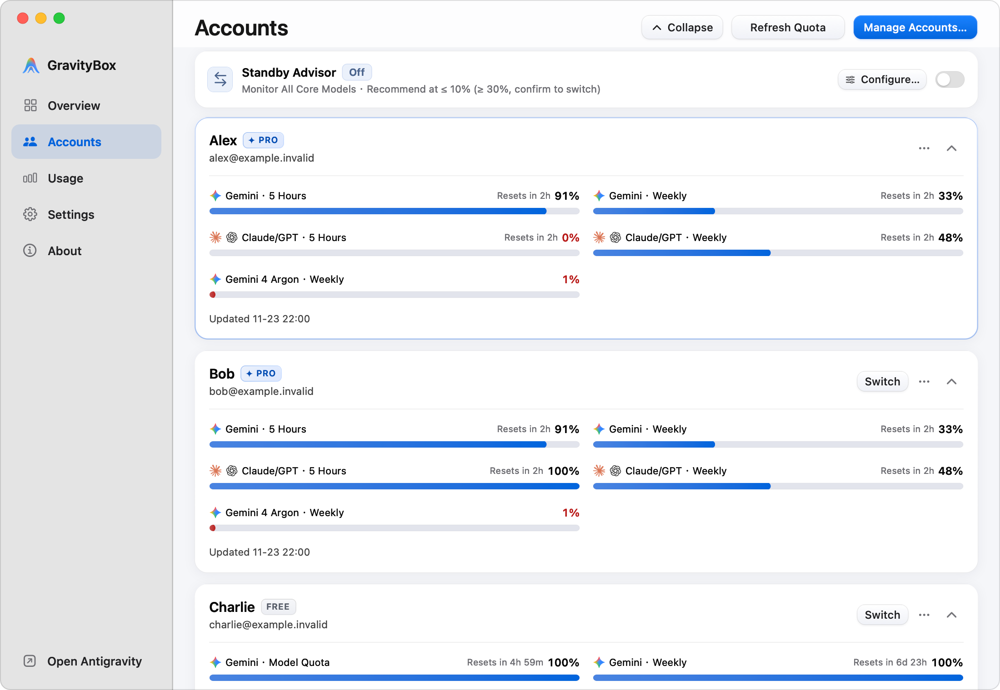
      </picture>
    </td>
  </tr>
  <tr>
    <td width="50%" align="center">
      <b>Usage &amp; API Cost</b><br /><br />
      <picture>
        <source media="(prefers-color-scheme: dark)" srcset="assets/screenshots/en-dark-usage.png" />
        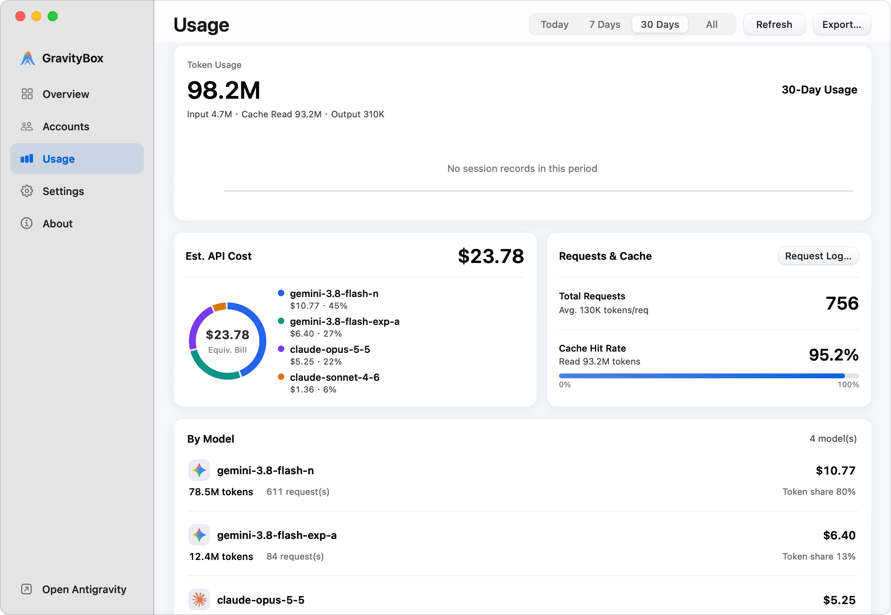
      </picture>
    </td>
    <td width="50%" align="center">
      <b>Settings</b><br /><br />
      <picture>
        <source media="(prefers-color-scheme: dark)" srcset="assets/screenshots/en-dark-settings.png" />
        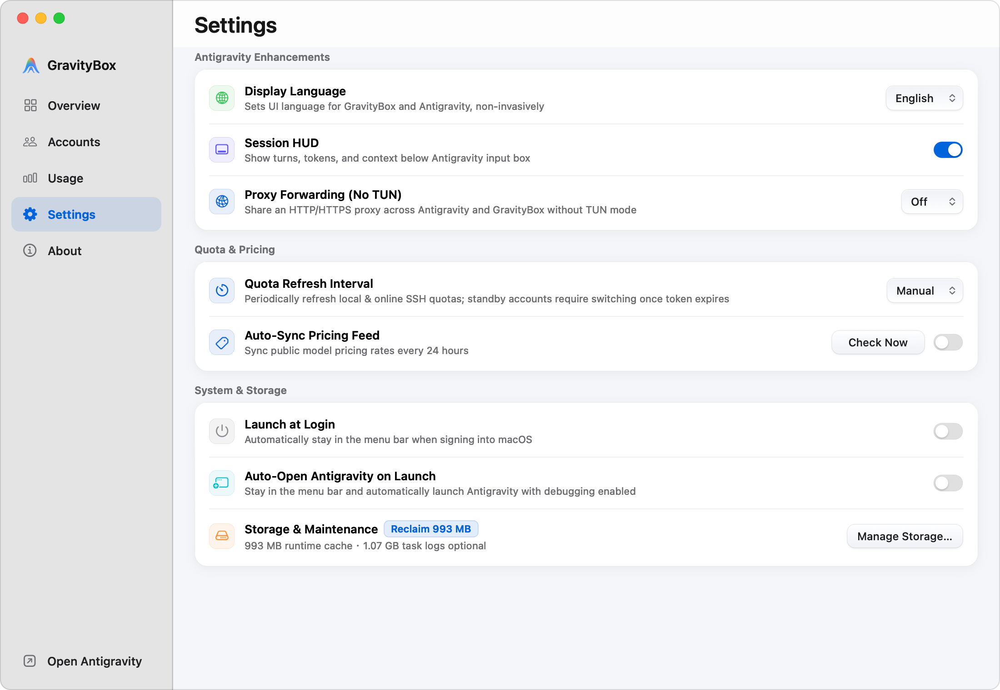
      </picture>
    </td>
  </tr>
</table>

<details>
<summary>More previews: Menu Bar Floating Panel, Storage Maintenance, and About</summary>
<br />
<table>
  <tr>
    <td width="33.3%" align="center">
      <b>Menu Bar · Usage</b><br /><br />
      <picture>
        <source media="(prefers-color-scheme: dark)" srcset="assets/screenshots/en-dark-menubar.png" />
        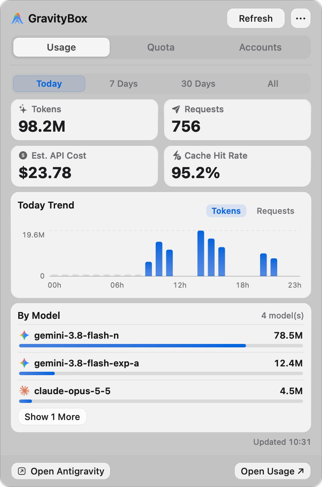
      </picture>
    </td>
    <td width="33.3%" align="center">
      <b>Menu Bar · Quota</b><br /><br />
      <picture>
        <source media="(prefers-color-scheme: dark)" srcset="assets/screenshots/en-dark-menubar-quota.png" />
        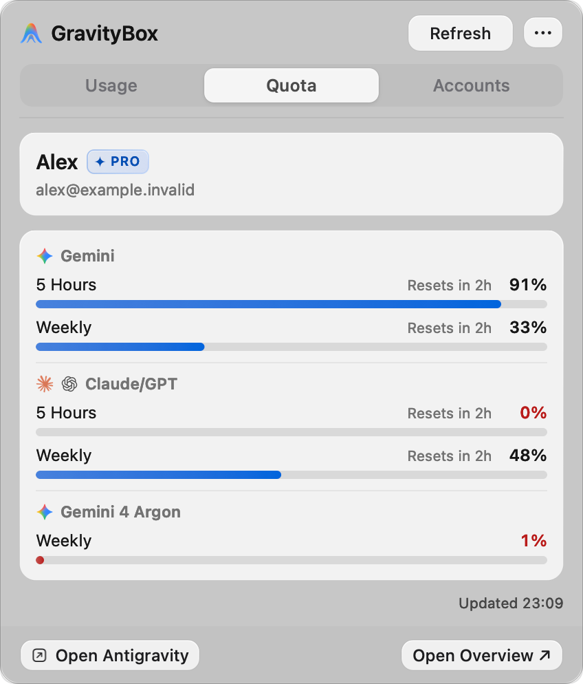
      </picture>
    </td>
    <td width="33.3%" align="center">
      <b>Menu Bar · Accounts</b><br /><br />
      <picture>
        <source media="(prefers-color-scheme: dark)" srcset="assets/screenshots/en-dark-menubar-accounts.png" />
        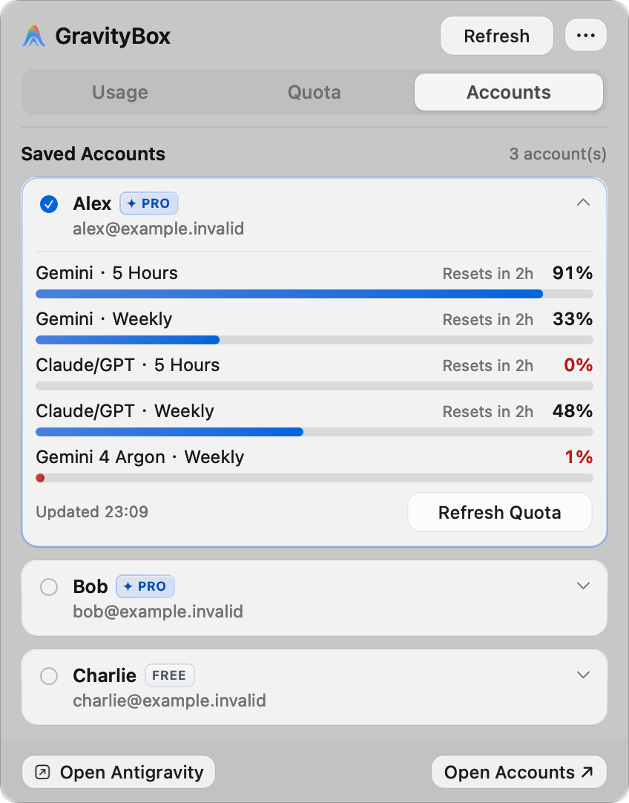
      </picture>
    </td>
  </tr>
  <tr>
    <td colspan="2" align="center">
      <b>Storage &amp; Maintenance (Trash + Undo)</b><br /><br />
      <picture>
        <source media="(prefers-color-scheme: dark)" srcset="assets/screenshots/en-dark-maintenance.png" />
        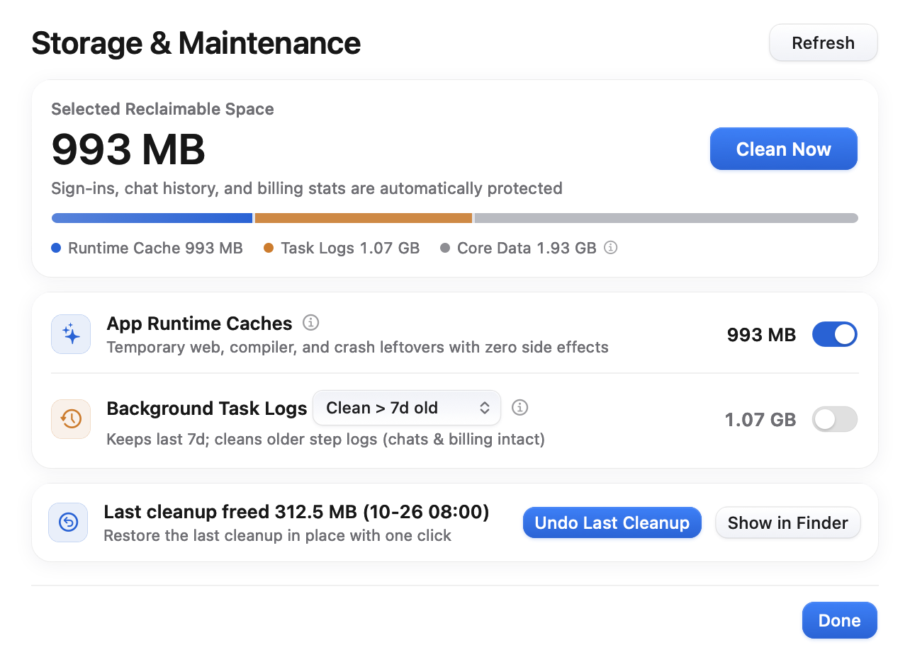
      </picture>
    </td>
    <td align="center">
      <b>About &amp; Updates</b><br /><br />
      <picture>
        <source media="(prefers-color-scheme: dark)" srcset="assets/screenshots/en-dark-about.png" />
        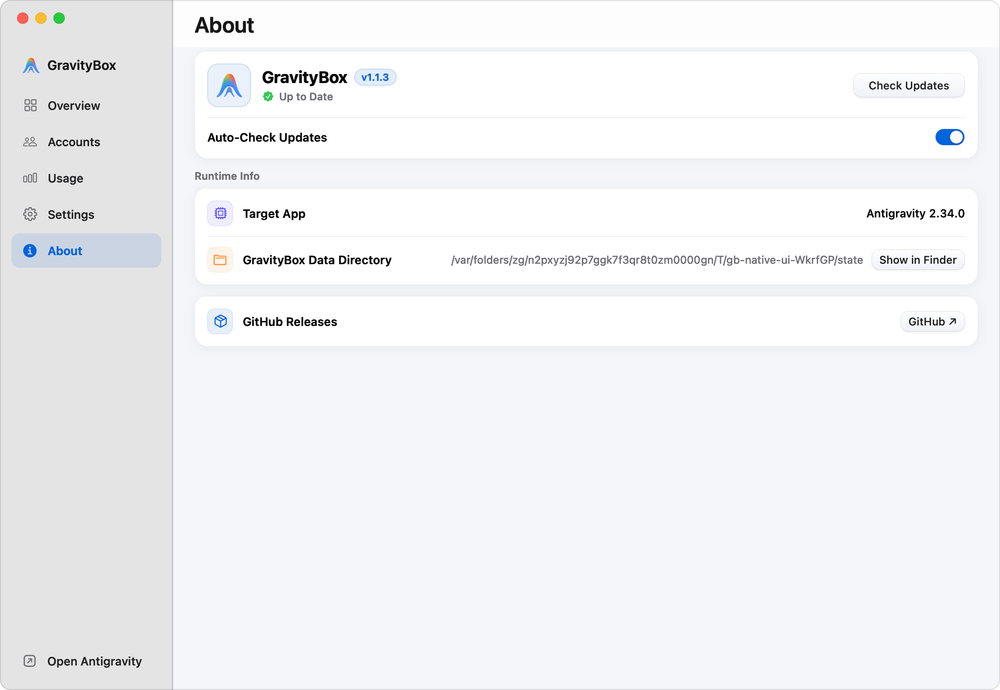
      </picture>
    </td>
  </tr>
</table>
</details>

### Key Behaviors in v1.2.2

- **Account Privacy Masking & Silent Delete Snapshot Cleanup**: Adds an inline pure-glyph eye toggle with subtle blink/fade motion (respecting Reduce Motion) next to account/section headers in **Overview**, **Accounts**, and the menu bar / tray panel, plus global shortcuts (`⇧⌘M` and the **View** menu on macOS; `Ctrl+Shift+M` on Windows). Masks nicknames (`first char + •••`) and emails across account cards, advisor banners, SSH companions, usage filters, request logs, switch/delete confirmations, accessibility labels, inline modal errors, and toasts—while keeping right-click raw email copy on macOS Overview and raw nicknames inside Rename inputs. Deleting an account automatically purges matching recovery credentials and snapshots in `account-switch-journal-stable.json` (including `go-keyring-base64:` payloads and double-Base64 Protobuf `userStatus` rows while protecting interrupted transactions) and stops writing `accounts-removed/` archives while clearing legacy entries for that account.
- **macOS Intel (`x86_64`) Source Build & Architecture-Safe Updater**: Derives Swift target triples, Mach-O single-architecture `lipo` assertions (main app + embedded Node), pinned headless test browser downloads (`mac-arm64` / `mac-x64`), and copyable About environment architecture labels from host architecture; in-app updates only accept packages matching the running build architecture. *(GitHub Releases distributes Apple Silicon `arm64` DMGs; Intel users build locally from source.)*
- **Auto-Open, Process Isolation & Safe Relaunch**: Enabling **Settings → Auto-Open Antigravity on Launch** keeps GravityBox in the menu bar / system tray and launches Antigravity with `--remote-debugging-port=0`; when Antigravity was opened without a debugging port, **Safe Relaunch to Connect** performs a graceful exit and reconnect (respecting Windows UIPI / same-user SID boundaries without force-killing), while isolating `chrome_crashpad_handler` and detached daemons (`language_server` / `sidecar`) during switching and maintenance.
- **Zero-SSH Remote Windows & Unified Local + SSH Ledger**: Adapts Antigravity `2.33.0+` SSH remote windows over local CDP without spawning external `ssh` processes—delivering bilingual UI, live HUD, isolated read-only `Local / SSH: <host>` quota views, and active-SSH safety reminders. Incrementally syncs remote usage into the local read-only SQLite ledger (deduplicated by trajectory ID with timeline attribution), surfacing `Local % · SSH %` splits and `Environment × Account` filters.
- **BTW Side-Question Isolation, `2.34.0` Catalog & View Guards**: Tracks `2.34.0+` BTW side-question panes in their own isolated HUD instance and deduplicates cloned prefix generations in usage accounting, alongside verified `2.34.0` dictionaries (`2.35.0+` adaptive fallback), `>200K` tiered pricing for `gemini-2.5-pro`, and localization guards protecting code, diffs, CSV viewports, LSP references, and notebook code/output regions.
- **TUN-Free HTTP / HTTPS Proxy Support**: Choose **Off**, **Follow System Proxy**, or **Manual** `http://` / `https://` proxy in **Settings** (PAC and SOCKS5 are not supported). Injects `HTTP_PROXY` / `HTTPS_PROXY` / `NO_PROXY` into Antigravity without needing a TUN mode, reuses the configured proxy for GravityBox outbound requests, and detects proxy mismatches or shell overrides.
- **JSON Account Management, `agy` CLI Sync & `2.34.0+` Standby Quotas**: Save the live account, batch-import JSON files/directories (deduplicated by email), or export confirmed backups (`0600` on macOS); switching and rollback sync existing `antigravity-oauth-token` and `jetski-standalone-oauth-token` CLI credentials without touching `@google/gemini-cli`. On `2.34.0+`, the active account refreshes live, while inactive standby accounts refresh before ~1-hour expiry, skip expired cloud polls silently, mark passed resets as **Est. Reset** for **Standby Advisor**, and sync live balances upon switching back.
- **Thinking-Variant Folding, Live Pricing Feed & Independent Language/HUD Control**: Usage summaries fold `-low` through `-max` and `-tiered` variants under each base model (preserving raw names in **Request Log**); supports live catalog updates via GitHub Raw / jsDelivr with `ETag` and SHA-256 verification, and hot-switches `Follow System` / `English` / `简体中文` while allowing Antigravity to stay in English with the English HUD enabled.

---

## Installation & Upgrades

- **macOS (Primary)**: Requires macOS 14 (Sonoma) or later and official stable `/Applications/Antigravity.app` (Insiders is neither supported nor altered). Zero external runtime dependencies.
  - Optional checksum check: `shasum -a 256 -c GravityBox-<version>-arm64.dmg.sha256`
  - Upgrade by quitting GravityBox and dragging the new app over `/Applications/GravityBox.app` (or enabling **Auto-Check Updates** in **About**, off by default).
  - GitHub Releases provides the Apple Silicon (`arm64`) DMG. On Intel (`x86_64`), run `npm ci && npm run verify && npm run package:mac` from source, then install the resulting local DMG; to upgrade on Intel, rebuild from the newer source.
- **Windows x64 (Community Edition)**: Requires Windows 10/11 x64, system WebView2 runtime, and official stable Antigravity. Prebuilt self-contained artifacts (`GravityBox-<version>-win-x64-setup.exe` and portable `GravityBox-<version>-win-x64.zip` with `.sha256` sidecars) are distributed via [GitHub Releases](https://github.com/Enzoo404/gravitybox/releases/latest)—**end users do not need to build from source**.
  - Optional PowerShell checksum check: `Get-FileHash GravityBox-<version>-win-x64.zip -Algorithm SHA256`
- **Persistent User Data**:
  - macOS: `~/Library/Application Support/GravityBox` (caches in `~/Library/Caches/GravityBox`)
  - Windows: `%APPDATA%\GravityBox` (caches in `%LOCALAPPDATA%\GravityBox\Cache`, logs in `%LOCALAPPDATA%\GravityBox\Logs`)

<details>
<summary>Optional: Background OAuth refresh credentials for expired standby accounts</summary>

No `.env` setup is required for daily use, active-account live quotas, HUD, usage accounting, or switching. If you provide your own compatible OAuth client credentials for continuous background cloud polling of expired standby accounts, place them in `~/Library/Application Support/GravityBox/.env` (macOS) or `%APPDATA%\GravityBox\.env` (Windows):

```bash
GRAVITYBOX_GOOGLE_CLIENT_ID="your-client-id.apps.googleusercontent.com"
GRAVITYBOX_GOOGLE_CLIENT_SECRET="your-client-secret"
```

</details>

---

## Security & Privacy

| Guarantee | Mechanism |
| :--- | :--- |
| **Zero Telemetry** | No analytics SDKs, crash reporting, or unprompted outbound traffic. Update checks and remote pricing sync default to Off. |
| **Untouched Official App** | Runs via local loopback (`127.0.0.1`) CDP isolated worlds; never unpacks or alters the official Antigravity bundle or executable. |
| **Protected User Content** | Composers, drafts, chat history, code blocks, diffs, CSV viewports, LSP references, notebook code/outputs, terminal logs, and workspace names are excluded by DOM allowlists/guards. |
| **Scoped Local Storage & IPC** | **macOS**: `~/Library/Application Support/GravityBox` (`0700`/`0600`), Keychain, and Unix Domain Socket IPC.<br/>**Windows**: `%APPDATA%\GravityBox`, Credential Manager (2560-byte guard & buffer zeroization), randomized Named Pipe with 256-bit `authToken` + same-user SID / integrity verification, strict Tauri CSP / URL allowlist, `IFileOperation` Recycle Bin guards, and UIPI-compliant graceful close. |
| **UI Masking & Delete Cleanup** | One-click privacy masking hides nicknames, emails, alerts/toasts, confirmations, and accessibility labels across surfaces. Deleting an account purges matching switch recovery credentials/snapshots and legacy `accounts-removed/` archives while never writing new deletion copies. |

---

## Architecture & Build

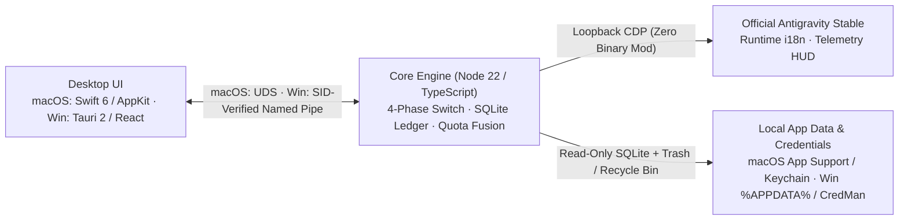

- **macOS Build**: Requires Xcode Command Line Tools and Node.js `>=22.15.0 <23` matching the build architecture (`arm64` or `x64`). Run `node tools/setup-test-browser.mjs` to prepare the pinned headless browser, or provide `CHROME_BIN`.
- **Windows Build**: Requires Windows 10/11 x64, Node.js `>=22.15.0 <23`, Rust (`cargo` / `rustc`), MSVC & WebView2 build tools (plus NSIS for `-setup.exe`). Maintainers/CI also produce prebuilt Windows artifacts via the manual `Package Windows (Artifact Only)` workflow.

```bash
git clone https://github.com/Enzoo404/gravitybox.git
cd gravitybox
npm ci

npm test                # Build TS, verify pricing parity, and run unit/integration suites
npm run check:swift     # Typecheck Swift 6 AppKit UI and test harness (macOS)
npm run verify          # Full gate: TS, tests, headless browser CDP E2E, Swift -O (macOS), dict gates
npm run package:mac     # Build .app and .dmg for the local macOS architecture (arm64 / x86_64)
npm run test:win        # Run backend fast tests + Win32 helper & Tauri Rust tests (Windows)
npm run package:win     # Build self-contained Windows .zip (pass --installer for NSIS .exe)
```

<details>
<summary>Repository layout</summary>

```text
gravitybox/
├── native/       # Swift 6 / AppKit console, MenuFloatingPanel, L10n runtime, updater (macOS)
├── src/          # Node 22 / TypeScript backend (IPC, i18n, atomic switch, quota, SQLite ledger, HUD, platform/)
├── windows/      # Co-located Windows x64 client (win-helper Rust Win32 helper + Tauri 2 / React app)
├── runtime/      # CDP isolated-world scripts (DOM localization engine, guards, Telemetry HUD)
├── dict/         # Layered bilingual dictionaries and custom overrides
├── ui-strings/   # Versioned official bundle extraction snapshots (2.23.0 – 2.34.0)
├── assets/       # Icons, i18n JSON packs, model catalog, pricing feed, macOS Retina screenshots
├── test/         # Unit, integration, headless Chromium E2E, cross-platform & Swift UI layout suites
└── tools/        # Release integrity, privacy check, docs parity, screenshot, DMG & Windows packaging scripts
```

</details>

---

## FAQ

<details>
<summary><b>Why must Antigravity be closed before switching accounts?</b></summary>

Antigravity holds live SQLite (`state.vscdb`) and credential locks while running. Force-killing or overwriting files underneath an active instance risks database corruption or lost drafts. GravityBox checks for a clean exit first (using graceful close only), writes via a 4-phase snapshot transaction, and rolls back automatically on failure—requiring user confirmation every time.

</details>

<details>
<summary><b>Can I use only the Telemetry HUD without translating the IDE?</b></summary>

Yes. Set **Settings → Display Language** to **English** and keep **Session HUD** enabled. Both GravityBox and Antigravity stay in English while displaying the English HUD beneath the chat composer.

</details>

<details>
<summary><b>How do I uninstall GravityBox?</b></summary>

Quit GravityBox (Antigravity requires no cleanup because its files are never altered):
- **macOS**: Move `/Applications/GravityBox.app` to Trash, and optionally remove `~/Library/Application Support/GravityBox`.
- **Windows**: Run the uninstaller (or delete the portable `GravityBox` folder), and optionally remove `%APPDATA%\GravityBox` and `%LOCALAPPDATA%\GravityBox`.

</details>

---

## Contributing, Acknowledgements & License

See [CONTRIBUTING.md](./CONTRIBUTING.md), [CODE_OF_CONDUCT.md](./CODE_OF_CONDUCT.md), [SECURITY.md](./SECURITY.md), and [CHANGELOG.md](./CHANGELOG.md). Feedback and bug reports are welcome via [GitHub Issues](https://github.com/Enzoo404/gravitybox/issues).

**Acknowledgements**:
- **Contributors**: `@Agonie0v0`, `@lvyandev`
- **Community**: Thanks to [LINUX DO](https://linux.do/) for providing an open-source sharing and technical discussion platform.

<div align="center">
  <a href="https://star-history.com/#Enzoo404/gravitybox&Date">
    
  </a>
</div>

<p align="center">
  <sub>Released under the <a href="./LICENSE">MIT License</a> · Third-party notices in <a href="./THIRD_PARTY_NOTICES.md">THIRD_PARTY_NOTICES.md</a> · Not affiliated with or endorsed by Google, Apple, or Microsoft.</sub>
</p>
